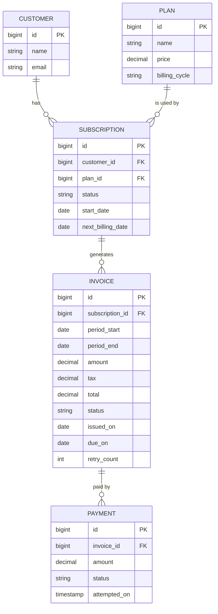

# Subscription Billing & Invoicing Engine

Live Link: https://subscriptionbillingengine.onrender.com/login.html
credentials: username - admin, pass - yazhi

A backend system that manages recurring subscriptions and automates billing, inspired by platforms like Chargebee and Stripe Billing. It handles the full billing lifecycle: plans, subscriptions, automated invoicing with GST, mock payments, failed-payment retries (dunning), mid-cycle upgrades with proration, and MRR reporting.

## Features

- **Customer, plan and subscription management** via REST APIs
- **Automated recurring billing**: a daily scheduler finds due subscriptions, generates invoices and advances the next billing date (monthly, quarterly and yearly cycles)
- **GST calculation**: 18% tax added to every invoice, using `BigDecimal` for accurate money handling
- **Idempotent billing runs**: each invoice stores its billing period, so the same period is never billed twice
- **Mock payment gateway**: simulates successful and failed payments with a configurable success rate
- **Dunning (payment retries)**: a retry scheduler re-attempts failed invoices up to 3 times, then marks the subscription `PAST_DUE`
- **Plan upgrades with proration**: credits unused days on the old plan and charges only the remaining days on the new plan
- **Subscription cancellation**: cancelled subscriptions are excluded from future billing
- **MRR report**: monthly recurring revenue and active subscriptions per plan
- **Global exception handling**: clear JSON error messages with proper HTTP status codes (400, 404)

## Tech Stack

| Layer | Technology |
|---|---|
| Language | Java 21 |
| Framework | Spring Boot (Web, Data JPA, Scheduling) |
| ORM | Hibernate / JPA |
| Database | PostgreSQL |
| Build tool | Maven |
| Utilities | Lombok |
| API testing | Postman |

## Architecture

```
Client (Postman / browser)
        |
   Controller        REST endpoints
        |
    Service          business logic (billing, proration, payments)
        |
   Repository        Spring Data JPA
        |
   PostgreSQL

   Schedulers: BillingScheduler (daily), RetryScheduler (daily)
```

### Project structure

```
com.yashika.SubscriptionbillingEngine
├── Controller        Customer, Plan, Subscription, Invoice, Report
├── Service           SubscriptionService, InvoiceService, PaymentService, ReportService
├── Repository        CustomerRepo, PlanRepo, SubscriptionRepo, InvoiceRepo, PaymentRepo
├── Entity            Customer, Plan, Subscription, Invoice, Payment
│   └── Enum          Status, BillingCycle, InvoiceStatus, PaymentStatus
├── dto               request and response objects
├── exception         custom exceptions and global handler
└── scheduler         BillingScheduler, RetryScheduler
```

## Database Design



### Status values

| Entity | Statuses |
|---|---|
| Subscription | `TRIAL`, `ACTIVE`, `PAST_DUE`, `CANCELLED` |
| Invoice | `PENDING`, `PAID`, `FAILED` |
| Payment | `SUCCESS`, `FAILED` |
| Billing cycle | `MONTHLY`, `QUARTERLY`, `YEARLY` |

## How It Works

### 1. Recurring billing (daily scheduler)
```
Find ACTIVE subscriptions with next_billing_date <= today
   -> generate invoice (amount + 18% GST)
   -> attempt payment through the mock gateway
   -> move next_billing_date forward by one billing cycle
```
Before creating an invoice, the engine checks whether one already exists for the same subscription and billing period. Running the scheduler twice never produces a duplicate invoice.

### 2. Payment retries (dunning)
```
Payment fails  -> invoice FAILED, retry_count + 1
Retry scheduler picks up FAILED invoices with retry_count < 3
Payment succeeds -> invoice PAID
3rd failure      -> subscription becomes PAST_DUE, retries stop
```

### 3. Upgrade with proration
Example: upgrading from Basic (Rs. 499) to Pro (Rs. 999) with 20 of 31 days left in the cycle.

| Step | Calculation | Result |
|---|---|---|
| Credit for unused Basic days | 499 x 20 / 31 | Rs. 321.94 |
| Charge for Pro, remaining days | 999 x 20 / 31 | Rs. 644.52 |
| Amount due | 644.52 - 321.94 | Rs. 322.58 |
| GST (18%) | | Rs. 58.06 |
| **Invoice total** | | **Rs. 380.64** |

### 4. MRR calculation
MRR is the sum of monthly plan prices across `ACTIVE` subscriptions. Quarterly plans are divided by 3 and yearly plans by 12.
Example: 2 Basic + 1 Pro = (2 x 499) + 999 = Rs. 1,997.

## API Endpoints

Base URL: `http://localhost:8080/billing`

| Method | Endpoint | Description |
|---|---|---|
| POST | `/Plan/create` | Create a plan |
| POST | `/Sub/create` | Subscribe a customer to a plan |
| GET | `/Sub/getAll` | List subscriptions |
| PUT | `/Sub/{id}/cancel` | Cancel a subscription |
| PUT | `/Sub/{id}/upgrade?newPlanId={planId}` | Upgrade the plan with proration |
| POST | `/Invoice/generate/{subscriptionId}` | Generate an invoice manually |
| GET | `/Invoice?subscriptionId={id}` | List invoices for a subscription |
| GET | `/reports/mrr` | Monthly recurring revenue report |

Customer and plan list endpoints follow the same pattern; see the controllers for the exact paths.

### Sample requests and responses

**Create a plan**
```http
POST /billing/Plan/create
Content-Type: application/json

{ "name": "Pro", "price": 999.00, "billingCycle": "MONTHLY" }
```

**Create a subscription**
```http
POST /billing/Sub/create
Content-Type: application/json

{ "customerId": 1, "planId": 3 }
```
```json
{
  "id": 1,
  "customer": { "id": 1, "name": "Subha", "email": "subha@gmail.com" },
  "plan": { "id": 3, "name": "Basic", "price": 499.00, "billingCycle": "MONTHLY" },
  "status": "ACTIVE",
  "startDate": "2026-10-05",
  "nextBillingDate": "2026-11-05"
}
```

**MRR report**
```http
GET /billing/reports/mrr
```
```json
{
  "mrr": 999,
  "activeSubscriptions": 1,
  "subscriptionsPerPlan": { "Pro": 1 }
}
```

**Error response**
```json
{
  "timestamp": "2026-10-15T13:32:06",
  "status": 404,
  "message": "Subscription not found"
}
```

## Getting Started

### Prerequisites
- Java 21
- Maven
- PostgreSQL

### Setup

1. **Clone the repository**
   ```bash
   git clone https://github.com/Yashika-sde/SubscriptionbillingEngine.git
   cd SubscriptionbillingEngine
   ```

2. **Create the database**
   ```sql
   CREATE DATABASE subscription_db;
   ```

3. **Configure the connection** in `src/main/resources/application.properties`
   ```properties
   spring.datasource.url=jdbc:postgresql://localhost:5432/subscription_db
   spring.datasource.username=postgres
   spring.datasource.password=${DB_PASSWORD}
   spring.jpa.hibernate.ddl-auto=update
   ```
   Change the port in the URL if your PostgreSQL does not run on 5432.

4. **Set the password as an environment variable** (never commit real credentials)
   ```bash
   # Linux / macOS
   export DB_PASSWORD=your-password

   # Windows (PowerShell)
   $env:DB_PASSWORD="your-password"
   ```
   In IntelliJ IDEA: Run > Edit Configurations > Environment variables > `DB_PASSWORD=your-password`.

5. **Run the application**
   ```bash
   mvn spring-boot:run
   ```
   The API starts at `http://localhost:8080`. Hibernate creates all tables automatically on first run.

### Try it out

1. Create a customer and two plans (Basic Rs. 499, Pro Rs. 999)
2. `POST /billing/Sub/create` to subscribe the customer
3. `POST /billing/Invoice/generate/1` to create an invoice (total Rs. 588.82 for Basic)
4. `PUT /billing/Sub/1/upgrade?newPlanId={proPlanId}` to see proration in action
5. `GET /billing/reports/mrr` to see the revenue report

### Testing the schedulers
The schedulers run daily (billing at 1 AM, retries at 2 AM). To test them quickly:

1. Temporarily change the schedule to `@Scheduled(fixedRate = 60000)` (every minute)
2. Make a subscription due:
   ```sql
   UPDATE subscription SET next_billing_date = CURRENT_DATE WHERE id = 1;
   ```
3. Start the app and check the `invoice` and `payment` tables
4. Restore the daily cron schedule afterwards

To see the retry flow, temporarily make the mock gateway always fail in `PaymentService` and watch `retry_count` reach 3 and the subscription become `PAST_DUE`.

## Design Decisions

- **`BigDecimal` for money**: avoids floating-point rounding errors (for example, 0.1 + 0.2 in `double`)
- **Idempotency via billing period**: the invoice stores `period_start`, and the engine checks it before creating a new invoice, which prevents double billing
- **Billing query uses `<= today`**: a missed day is billed on the next run instead of being skipped forever
- **Mock payment gateway**: keeps payment logic isolated in `PaymentService`, so a real gateway such as Razorpay or Stripe can replace it without changing the rest of the engine
- **Layered architecture**: controllers handle HTTP, services hold business rules, repositories handle data access

## Future Improvements

- Downgrades with credit notes
- Delay between retry attempts (for example, retry after 2, 4 and 6 days)
- Free trial handling with automatic conversion to a paid plan
- Real payment gateway integration (Razorpay / Stripe)
- Authentication and role-based access (admin vs support)
- Unit and integration tests with JUnit and Mockito
- Simple dashboard (HTML/CSS) for invoices and MRR

## Author

**Yashika**
GitHub: [Yashika-sde](https://github.com/Yashika-sde)
